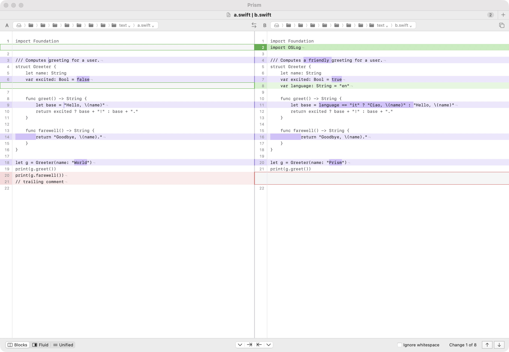

# Prism Diff

Prism is a native macOS application for comparing text files and folders,
and for merging them, written in Swift with AppKit. It is free software,
released under the Apache License 2.0.

- **Text comparison** in three layouts (Blocks, Fluid and Unified), with
  changed words highlighted inside changed lines, find, line wrapping and an
  option to ignore whitespace at the line edges.
- **Editing and two-way merge:** copy changes from one side to the other,
  type in either side, undo, and save in the file's own encoding.
- **Three-way merge** for `git mergetool`: changes made on one side only are
  taken automatically, and each conflict is resolved with a choice or by
  hand.
- **Folder comparison:** both trees side by side, filters for changed,
  unchanged and unmatched items, and copying across in either direction.
- **Version-control integration:** `git difftool` shows every changed file in
  one window; Mercurial, Subversion and Perforce work through `prism` too.
- **Tabs, a file shelf** for comparing more than two files, and windows that
  come back after a relaunch.
- **Accessibility:** every control is named for VoiceOver, everything works
  from the keyboard, and Prism follows the Increase Contrast and Reduce
  Motion settings.

Prism comes with one command-line tool, `prism`:

- `prism A B` (and the `ksdiff`-compatible options) opens a comparison in
  the Prism app; version-control tools and editors call it this way;
- `prism diff`, `prism sniff` and `prism merge3` run the comparison engine
  in Terminal, without the app. To open a file that is literally named
  `diff` (or `sniff`, `merge3`), write `./diff`.

Prism is an independent open-source project, not affiliated with Kaleidoscope.
The `prism` command accepts the same options as `ksdiff` for compatibility.

## Screenshots



## Installing

Prism runs on macOS 14 (Sonoma) or later, on Apple silicon Macs.

1. Download `Prism-<version>-macos-arm64.zip` from the
   [latest release](https://github.com/pditommaso/prism-diff/releases/latest).
2. Unzip it and move `Prism.app` to `/Applications`.
3. Open it once as described below.

Releases are ad-hoc signed, not notarized by Apple, so the first time you
open Prism macOS refuses to start it. Either:

- in the Finder, right-click (or Control-click) `Prism.app`, choose **Open**,
  then **Open** again in the dialog; or
- clear the quarantine flag that the browser set on the download:

  ```sh
  xattr -dr com.apple.quarantine /Applications/Prism.app
  ```

New versions are published on the
[releases page](https://github.com/pditommaso/prism-diff/releases): download
the new zip and replace the app (there is no automatic update).

## The `prism` command

### With the Integration window

Choose **Prism > Integration…**, select the command-line tool in the list,
and click **Install…**. Prism links `prism` into `/usr/local/bin` or `~/bin`
(you choose where when both are possible). If another `prism` command is
already on your `PATH`, Prism offers to link its own as `prism-diff`
instead. **Remove…** deletes the link again.

### By hand

The command lives inside the app bundle:

```sh
ln -s /Applications/Prism.app/Contents/Helpers/prism /usr/local/bin/prism
```

(Use `~/bin` instead of `/usr/local/bin` if you cannot write there, and make
sure that folder is on your `PATH`.)

### Using it

```sh
prism draft-1.txt draft-2.txt      # compare two files in Prism
prism old-site/ new-site/          # compare two folders
prism --wait a.txt b.txt           # return when the window closes
prism ./diff other.txt             # a file named "diff" needs ./
prism diff a.txt b.txt             # unified diff in Terminal, no app needed
prism diff --side-by-side --color a.txt b.txt
prism merge3 --json base.txt mine.txt theirs.txt
```

`prism diff` exits like diff(1): 0 when the files are equal, 1 when they
differ, 2 on errors. The full grammar of both uses (opening the app, and
the engine commands) is in
[docs/spec-public/prism-cli.md](docs/spec-public/prism-cli.md).

## Git difftool and mergetool

The **Git** entry of the Integration window sets git up for you, either as
the default tool or as an extra one (`git difftool -t prism`), and its
**Remove** button restores your git configuration exactly as it was.

To do it by hand (`prism` must be on your `PATH`):

```sh
git config --global difftool.prism.cmd 'prism --partial-changeset --relative-path "$MERGED" -- "$LOCAL" "$REMOTE"'
git config --global mergetool.prism.cmd 'prism --merge --output "$MERGED" --base "$BASE" -- "$LOCAL" --snapshot "$REMOTE" --snapshot'
git config --global mergetool.prism.trustExitCode true

# optional: make Prism the default
git config --global diff.tool prism
git config --global merge.tool prism
git config --global difftool.prompt false
git config --global mergetool.prompt false
```

Then:

- `git difftool` (or `git difftool -t prism`) opens every changed file in
  one Prism window, with the list of files beside the comparison;
- `git mergetool` opens each conflicted file in a three-way merge window.
  Save the result with every conflict resolved and close the window: git
  marks the file resolved. Closing it any other way tells git the merge is
  not finished.

## Building from source

Prism builds with the Swift 6 **Command Line Tools only**; Xcode is not
required.

```sh
xcode-select --install          # once, if the Command Line Tools are missing
swift build                     # debug build
swift test                      # run the test suite
swift build -c release          # optimised build
scripts/bundle.sh               # assemble and ad-hoc sign build/Prism.app
open build/Prism.app
```

`scripts/bundle.sh` also writes `build/Prism-<version>-macos-arm64.zip`.
`scripts/ci/build-strict.sh` builds with warnings treated as errors, and
`scripts/accept/` holds the acceptance scripts of each milestone
(`CI=true scripts/accept/MNN.sh` runs only their headless checks;
`scripts/accept/a11y-audit.sh` runs the accessibility audit).

## Help

**Help > Prism Help** in the app covers opening comparisons, the layouts,
merging, folders, the command-line tools, git setup, accessibility and every
keyboard shortcut.

## Contributing

Please read [CONTRIBUTING.md](CONTRIBUTING.md) before opening a pull request.
In short: every commit must be signed off (`git commit -s`), every source file
carries an SPDX header, and contributions must follow the clean-room rule.

## Licence

Prism is released under the [Apache License, Version 2.0](LICENSE).
See [NOTICE](NOTICE) for attribution.

The `prism` command accepts the same options as `ksdiff` for compatibility.

## Clean-room re-implementation

Prism is a clean-room re-implementation of **Kaleidoscope 2.3**, the macOS
file and folder comparison app originally published by Black Pixel (version
2.3.1, built for Intel Macs in 2020). It aims to reproduce that version's
features and look, rebuilt as native Apple-silicon code with an open-source
licence. Later Kaleidoscope releases were not studied. No code, text, images
or other assets of the original are included.

The work was split into two separate roles:

1. **Specification.** The original app was studied as a user would see it:
   it was run on real files and git repositories, and every menu, shortcut,
   preference, layout and `ksdiff` / `git difftool` / `git mergetool`
   behaviour was recorded with screenshots and notes. The app bundle (its
   frameworks, symbol names, file types and command-line grammar) was
   examined only to understand what had to be built. From this, written
   behavioural specifications were produced in our own words. The screenshots, notes and
   specifications stay private and are not part of this repository.
2. **Implementation.** Prism was written from those specifications only, in
   Swift, with an independent design: its own diff engine, text rendering,
   folder scanner, socket protocol and user-interface wording. The
   developers never looked inside the original binary and never copied its
   strings, class names, icons or artwork. Architecture choices were made
   with measured prototypes, not by imitating the original's internals.

Automated guards keep the boundary in place: CI rejects the original's
identifiers and assets, and `scripts/ci/cleanroom-audit.sh` compares every
string literal and image in the repository against fingerprints of the
original's distinctive text and screenshots (only hashes are stored), and it
reports no matches. The work was organised in twelve milestones, each with
automated acceptance checks; see [CHANGELOG.md](CHANGELOG.md).

Prism is an independent open-source project, not affiliated with Kaleidoscope.
"Kaleidoscope" is a trademark of its respective owner.

